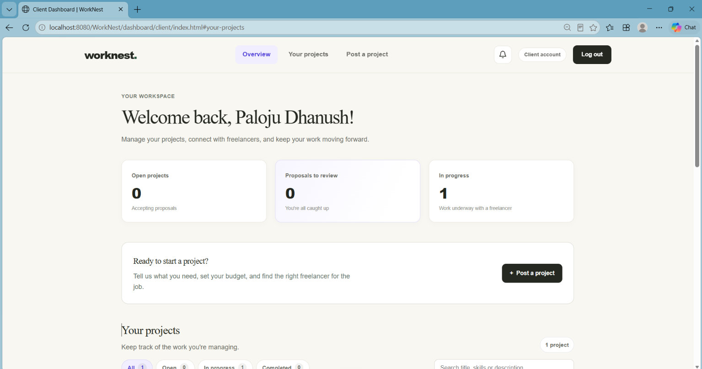
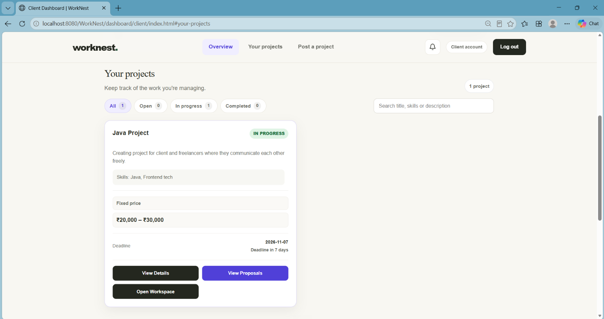
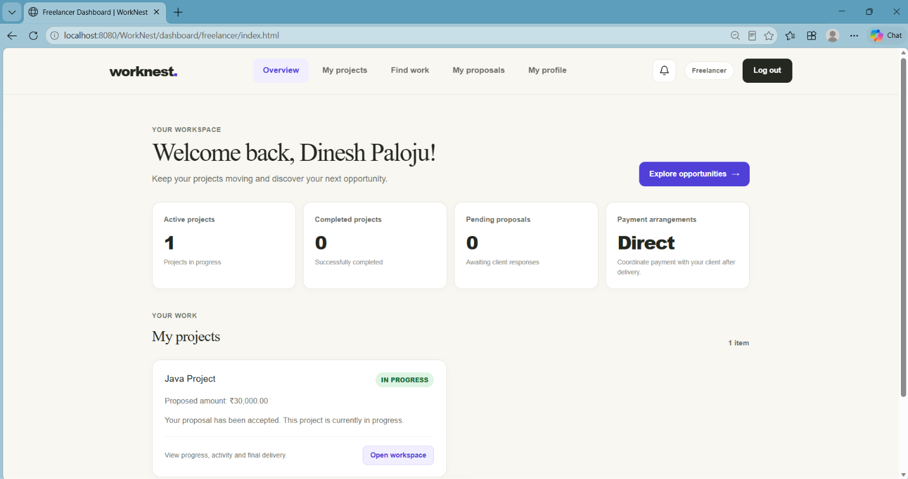
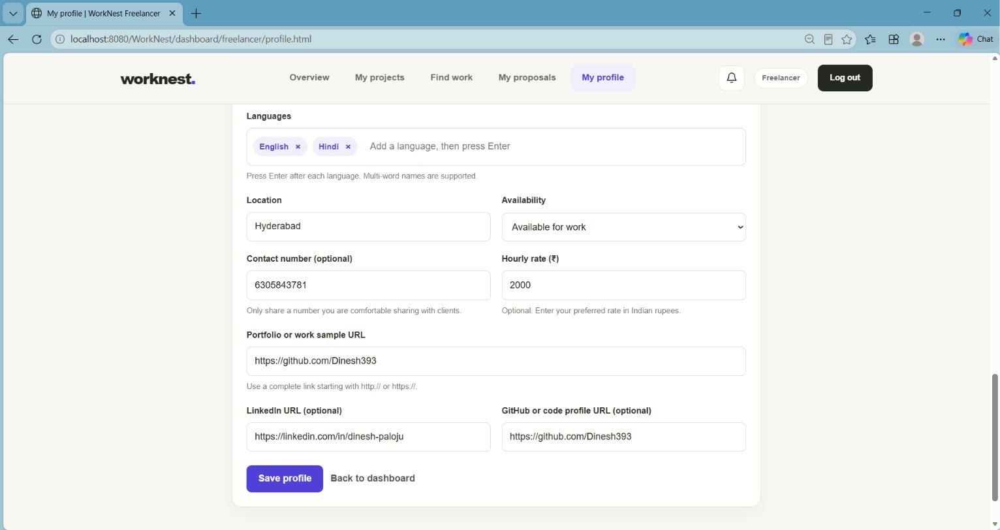
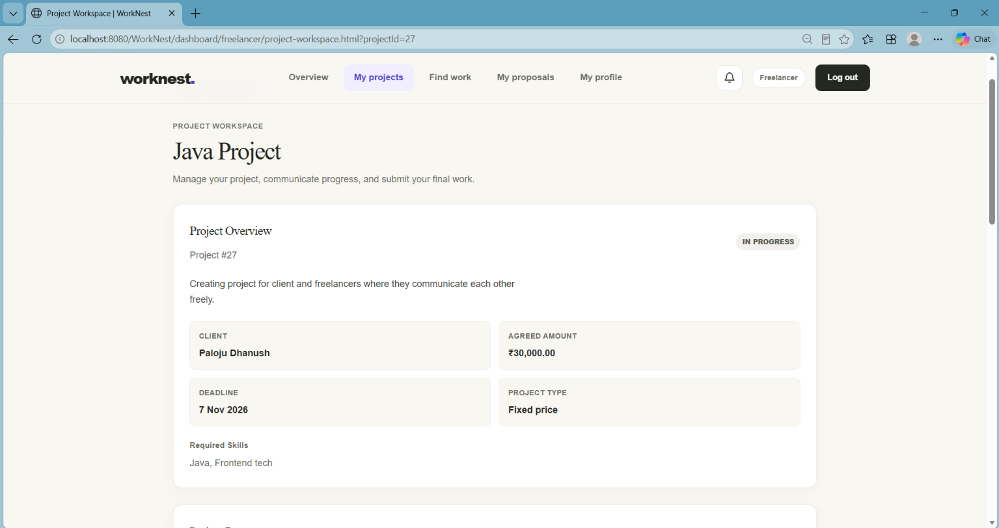

# WorkNest

WorkNest is a project collaboration platform for clients and freelancers. Clients post work, review proposals or invite a freelancer, then track progress and delivery in a shared workspace.

## Features

### For clients

- Create, edit, view, and cancel projects.
- Draft project details from a short summary with AI, then review and edit the suggestions.
- Review freelancer proposals, with an AI summary and best-fit suggestion for pending proposals.
- Search freelancer profiles, filter and sort results, keep a shortlist, and invite freelancers to a project.
- Follow progress updates, review submitted work, approve delivery, or request a revision.
- Manage personal and organization profile details and receive project notifications.

### For freelancers

- Create and maintain a professional profile.
- Browse open projects and submit proposals with an optional AI-assisted cover-letter draft.
- Track proposals and client invitations; accept or decline invitations.
- Post progress updates, submit delivery, and receive project notifications.

AI suggestions are optional and should be checked before use. AI features require a Gemini API key and are subject to provider availability and limits.

## Technology

- Java 17, Java Servlets 4.0
- Apache Tomcat 9
- HTML, CSS, JavaScript
- MySQL with MySQL Connector/J and TLS-required JDBC connections
- Tomcat JDBC connection pool
- Gemini API for optional AI assistance
- Docker and Render deployment configuration

## Project structure

    WorkNest/
    ├── database/                         # Schema and feature SQL scripts
    ├── docs/
    │   ├── screenshots/                  # Screenshots shown below
    │   └── AIVEN_RENDER_DEPLOYMENT.md    # Deployment configuration notes
    ├── src/main/java/                    # Servlets, filters, listeners, and utilities
    └── src/main/webapp/                  # Public pages, dashboards, assets, and WEB-INF
        ├── dashboard/client/
        ├── dashboard/freelancer/
        ├── css/
        ├── js/
        └── WEB-INF/

## Screenshots

Place screenshots with these filenames in docs/screenshots/; GitHub will render them below.

### Client dashboard

### Client project and proposals

### Freelancer dashboard

### Freelancer profile

### Project workspace

## Requirements

- JDK 17
- Apache Tomcat 9
- MySQL 8 compatible database (local or remote)
- Eclipse IDE with Web Tools Platform for the Eclipse workflow
- Docker for container builds; optional for local Eclipse development

## Configuration

WorkNest reads secrets from the environment. Do not put credentials in Java, HTML, JavaScript, Docker build arguments, or Git.

| Variable | Required | Purpose |
| --- | --- | --- |
| APP_ENV | Render sets `production` | Marks session cookies Secure in production; leave unset for local HTTP development. |
| DB_URL | Yes | MySQL JDBC URL. Include sslMode=REQUIRED for TLS. |
| DB_USERNAME | Yes | Database login name. |
| DB_PASSWORD | Yes | Database password. |
| GEMINI_API_KEY | Optional | Enables AI drafting and summaries. |
| GEMINI_MODEL | Optional | Overrides the configured Gemini model when needed. |
| PORT | Container runtime | Render supplies the port; local container runs default to 10000. |

Example URL shape (replace the placeholders; do not commit real values):

    jdbc:mysql://YOUR_HOST:YOUR_PORT/YOUR_DATABASE?sslMode=REQUIRED

## Database setup

The scripts in database/ are not automatically executed by the application or container. schema.sql creates the core tables for a fresh local database. Feature scripts add profile, notification, and invitation tables. Review the target database and the exact SQL before running any script against an existing database.

remove_client_profile_verification.sql is a one-time migration for a specific older client-profile schema. It drops columns and must only be used when that older schema is present and the change is intended. Do not run it as general setup. Back up an existing database before any migration.

## Run locally in Eclipse

1. Import the repository with File → Import → Existing Projects into Workspace.
2. Set the project JRE and compiler to JDK 17. Configure an Apache Tomcat 9 server runtime.
3. Create a MySQL database and apply the needed schema scripts after reviewing their contents. Use a fresh local database for schema.sql.
4. In the Tomcat launch configuration, add DB_URL, DB_USERNAME, and DB_PASSWORD. The JDBC URL must include sslMode=REQUIRED.
5. To enable AI, add GEMINI_API_KEY to the Tomcat environment. Keep the key private. GEMINI_MODEL can be set when a model override is needed.
6. Start Tomcat and open the context path shown in the server console, commonly http://localhost:8080/WorkNest/.

## Build and run with Docker

From the repository root:

    docker build -t worknest .
    docker run --rm -p 10000:10000 -e DB_URL='jdbc:mysql://YOUR_HOST:YOUR_PORT/YOUR_DATABASE?sslMode=REQUIRED' -e DB_USERNAME='YOUR_DATABASE_USER' -e DB_PASSWORD='YOUR_DATABASE_PASSWORD' -e GEMINI_API_KEY='YOUR_GEMINI_KEY' worknest

Use real secrets only in your local shell or a private secret manager. Do not save them in a tracked file.

## Render deployment

The repository includes render.yaml and a Dockerfile for a Render web service. The container compiles for Java 17 and Tomcat listens on the PORT supplied by Render. render.yaml declares the database and Gemini values as secret environment entries (sync: false); enter their values in Render when prompted. If the service already exists, add or update them in Render's Environment settings.

Use an external MySQL service that allows secure connections from the deployed application. Add DB_URL, DB_USERNAME, and DB_PASSWORD in Render. Add GEMINI_API_KEY only if you want AI features enabled. Do not add a database to the Render Blueprint; the database remains an independently managed service. Free web services may sleep while idle and have usage limits, so plan for a startup delay after inactivity.

See [Aiven and Render deployment notes](docs/AIVEN_RENDER_DEPLOYMENT.md) for the deployment checklist.

## Main workflow

1. A client posts a project.
2. A freelancer submits a proposal, or the client sends a direct invitation.
3. The client accepts a proposal, or the freelancer accepts the invitation.
4. Both people use the project workspace while work is underway.
5. The freelancer posts updates and submits the delivery.
6. The client approves the delivery or requests a revision.

## Security notes

- Keep database credentials, Gemini keys, certificates, and private keys out of the repository.
- Unsafe POST, PUT, PATCH, and DELETE requests use session-bound CSRF tokens. Session cookies are HttpOnly and SameSite=Lax; Render sets Secure through APP_ENV=production.
- AI requests send the relevant project or profile text to the AI provider for processing. Do not include confidential information in AI prompts.
- Use test data in screenshots and remove personal account details before publishing.
- Review staged files before committing or pushing.

## License

No license is currently included. Add a LICENSE file if you want to define how others may use or contribute to this project.